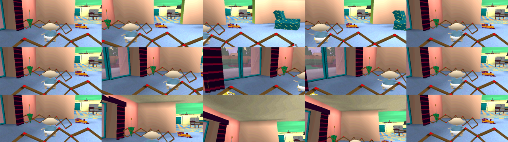
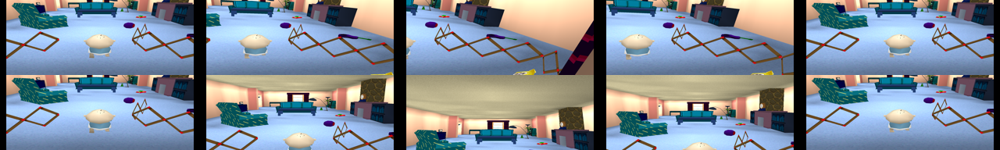

# 64. L1, L2 and R2 look aside

The camera's look buttons are ported from 0x8002729c, 0x800247fc and 0x8001e838 (docs/engine/gameplay.md, The look buttons). Before this, L2 and R2 turned the follow camera 341 for good and L1 did nothing, which was wrong (the audit's B5 left L1 open).

- **A look** starts only with the follow camera, none under way, and the player not floating (state 21):
  - L1 (0, 341), L2 (-341, 0), R2 (341, 0).
- **Each frame** the offset eases out toward its target and back to 0. The step is (rsin(offset * 2048 / target) / 16 + 128) * 136 / 4096, so 4 to 12 a frame. At 0 the look ends.
- **The view** turns about the eye: yaw toward the right, pitch up. R1 drops the look as well as putting the camera behind.
- **Rust:** world::game::camera::Look, stepped in the frame and applied to the view rows in draw.

**Checked against the oracle** (rugrats-hle into the hub, then each button):
- R2 looks right, L2 left, L1 up at the ceiling. Each is back in about 100 game frames, with 0x800de430..43c back to 0 and 0x800c4a3c at 0x9c0.
- The port's headless run shows the same directions and about 90 frames.

**Still unknown:**
- Which of the matrix conventions makes rotY pre-multiply and rotX post-multiply in 0x8001e838. The port applies both about the eye's own axes, which matches the oracle's pictures, but no pixel compare was made.
