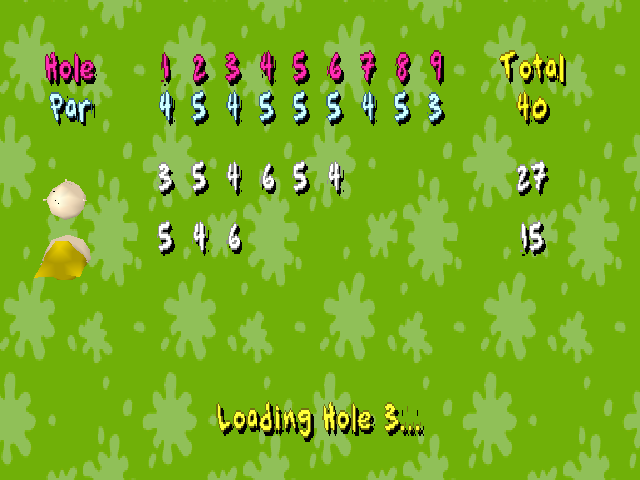
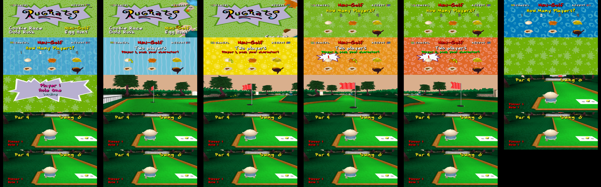

# 67. Golf round: the Loading Hole card and player 1's banner

Between holes, an activity mini-golf round now follows golf.md's 0x80096a30 steps 4, 6.4 and 8.

- **After the last player of holes one to eight**, one frame of the score card with "Loading Hole %d..." (202, 0x1ec8c8, centred at y 80). It is held through the load like a loading page. Then the card with PRESS X until Cross.
  - Page::Scores now has `loading: Option<u32>` in place of `press`.
  - The Cross sound now plays only on Cross. Before, it also played when the card ended by itself.
- **Holes two to nine** skip the level's own loading page; the score card stood in for it. Player 1's banner ("Player 1 / Hole n") follows the hole's cine. Before, the banner only showed for players 2-4.
- **Test** (app::play::tests, a_golf_round_takes_turns_and_holes): a two-player round driven through the app's exit and enter steps on the real disc.
  - Player 2's banner keeps the same Game.
  - The last player's strokes give the cards and Enter(hole two).
  - Hole two starts with its cine, then the banner.
  - The strokes land in the right cells.
- **Run headless** through the title: Activities, Mini-Golf, two players, Tommy and Chuckie picked. Then "Player 1 / Hole One / Loading", cine 31, and Tommy at the tee with "Par 4", "Swing 0" and "Player 1 / Hole 1" (attached).

**Still unknown:**
- The count's wobble on the setup screen is not ported.
- A whole round played by hand (real swings into the cup) is not checked headless; the test drives the exits directly.
