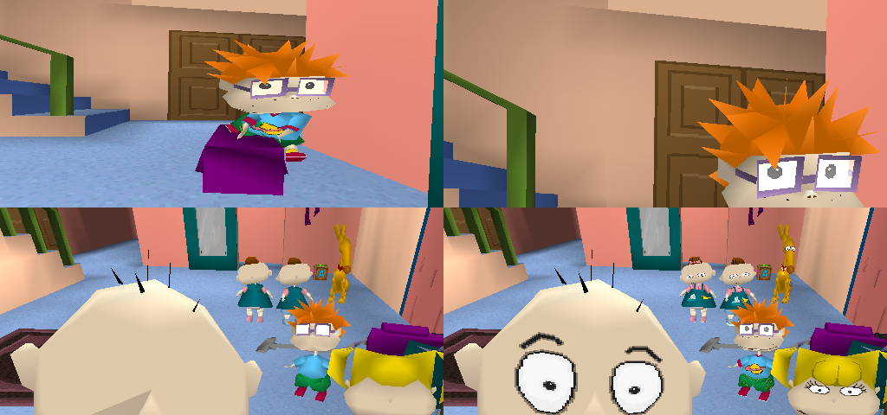
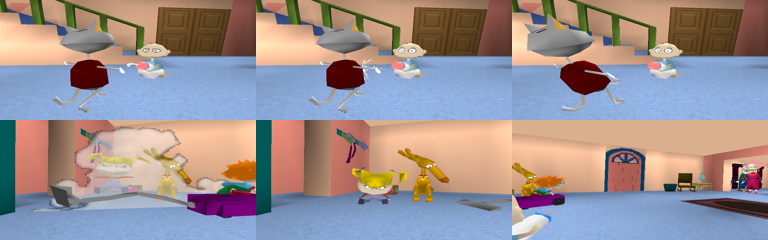

# 84. Faces lost their eyes: model faces drawn in AddPrim's order

The user found every character without eyes: on the title, in the opening and in play. Some heads also showed their back over their face, and the opening's milk was hard to see. "Creepypasta level."

- **Bisected** with opening_shot at frame 800: 2ac620b (faces added) has Chuckie's eyes; c6ca2cf has them; 396e989 does not. That commit made the opaque depth test LessEqual, so a coplanar decal over its floor is drawn.
- **Why:** a character's pupils, eye whites, brows, mouths and shirt prints are faces coplanar with the ones under them. On the PlayStation the model renderer adds each face's packet at the head of its ordering-table slot (AddPrim), so of two at one depth the earlier face is drawn later, on top. The port drew faces in list order. With LessEqual the later face won: the eye white over the pupil, the skin over the eye.
- **Fix:** models::model_triangles puts the faces out last first. Under LessEqual the earlier face wins a tie, as AddPrim's order makes it; room decals keep their behaviour.
- **Checked:** frames 100-1400 of the opening and the title. Eyes are back on Tommy, Chuckie, Phil, Lil, Angelica and Spike, Chuckie's shirt prints are back, and Tommy's face shows where the back of his head was. The milk spray (records 600-608) and the lens splash (836) draw. 68 tests pass.

**Still unknown:**
- The original sorts by OT depth (the faces' average z with the flags' bits 8-9); the port relies on the depth buffer plus this order. A face pair at different z that the OT draws in the other order is not covered.
